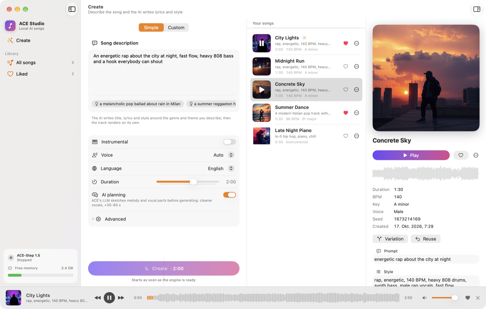
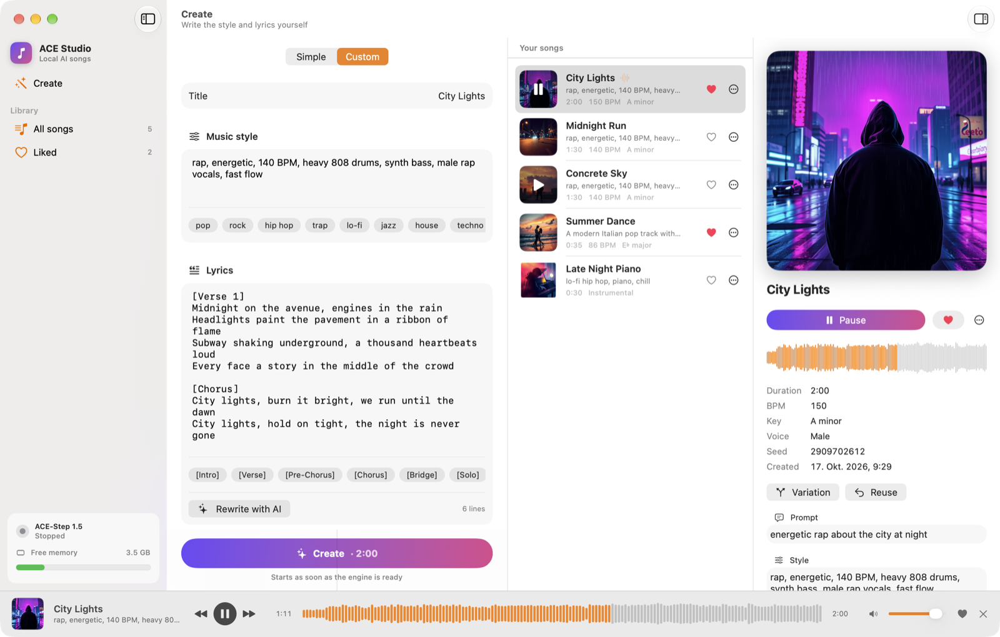
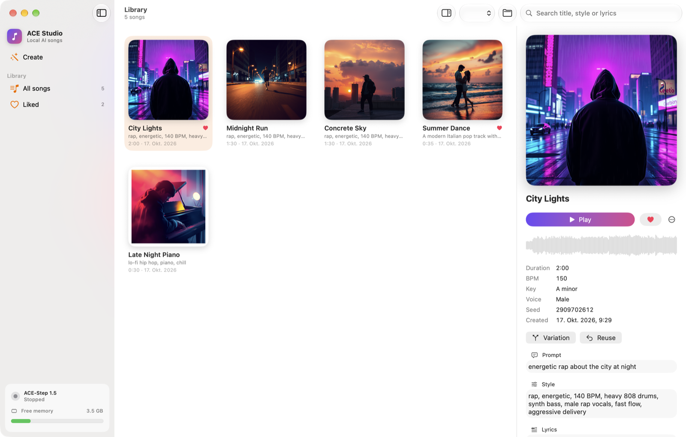

# ACE Studio

A native macOS (SwiftUI) front-end for a local [ACE-Step 1.5](https://github.com/ace-step/ACE-Step) install.
Describe a song, and ACE Studio writes the lyrics and style, drives the local ACE-Step engine, and
keeps a browsable library of the generated tracks — entirely on your own machine.

Built for Apple Silicon and tuned to run 16 GB-safe (`MLX` DiT + VAE in fp16, LLM off, batch 1).

## Screenshots

<p align="center">
  
</p>

| Custom mode: your own style tags and lyrics | Library: AI cover art for every track |
| :---: | :---: |
|  |  |

> The screenshots use demo tracks and covers generated with FLUX.1-schnell on the IONOS AI Model Hub.

## Features

- **Simple mode** — describe what you want (theme, energy, mood); an LLM writes the lyrics and a
  genre-first style prompt, then the song is generated.
- **Custom mode** — bring your own style tags and lyrics, control BPM, key, seed, duration, and voice
  (Auto / Female / Male / Duet), with an optional instrumental track.
- **Library** — browse, play, like, rename and delete tracks, with a built-in lyrics inspector.
- **Cover art** — deterministic procedural covers per track, plus optional AI cover generation.
- **RAM-aware engine management** — the app pauses RAM-hungry background services (Qwen TTS, Jarvis)
  while the engine is running and restores them on quit, via a detached watchdog.
- **Lyrics assistant** — writes lyrics and a genre-first style in the language of your description
  (or the one you pick). Built in: IONOS AI Model Hub (Qwen3.5-397B, gpt-oss-120b as fallback), with a
  final fallback to the ACE-Step built-in language model.
- **Bring your own model** — in Settings → Lyrics → *Add model…* add Anthropic Claude, xAI Grok,
  OpenRouter (including its free models), Groq, Google Gemini, Mistral, DeepSeek, OpenAI or any
  OpenAI-compatible server (e.g. LM Studio). Load the model list from the service, test it, and pick it
  as the writer. API keys are stored in the macOS Keychain.

## Requirements

- macOS 15 or later (Apple Silicon recommended).
- Xcode command-line tools (`swift`).
- A local [ACE-Step 1.5](https://github.com/ace-step/ACE-Step) checkout at `~/ACE-Step-1.5`.
- [`uv`](https://github.com/astral-sh/uv) on `~/.local/bin/uv` or `/opt/homebrew/bin/uv`.

## Build

```sh
./build.sh
```

This produces an ad-hoc-signed `dist/ACE Studio.app` and bundles the app icon
(`tools/make_icon.swift` generates `AppIcon.icns` if it is missing). Then launch it:

```sh
open "dist/ACE Studio.app"
```

## Configuration

| What | Where |
| --- | --- |
| ACE-Step checkout | `~/ACE-Step-1.5` |
| Engine HTTP API | `http://127.0.0.1:8001` |
| Song library | `~/Music/ACE Studio` |
| Logs | `~/Library/Logs/ACEStudio` |
| IONOS API key (optional) | stored in the macOS Keychain, set from **Settings** |

The IONOS key is optional. Without it, ACE Studio falls back to the ACE-Step built-in language model
for lyrics and procedural cover art.

## Debug flags

Passed as launch arguments:

| Flag | Effect |
| --- | --- |
| `--test-simple "<description>" <sec>` | Generate in simple mode, then exit |
| `--test-song "<style>" <sec>` | Generate an instrumental custom song |
| `--section library\|liked` | Open a given section at launch |
| `--select-first` | Select the first track |
| `--mode-custom` | Start in custom mode |
| `--play-first` | Start playback of the first track |
| `--voice <auto\|female\|male\|duet>` | Preset the voice |
| `--import-ionos-key <file>` | Import the IONOS key from a file |
| `--missing-covers` | (Re)generate missing cover art |
| `--window-shot <file.png> --delay <sec>` | Save a screenshot of the app window |

## License

[MIT](LICENSE).
